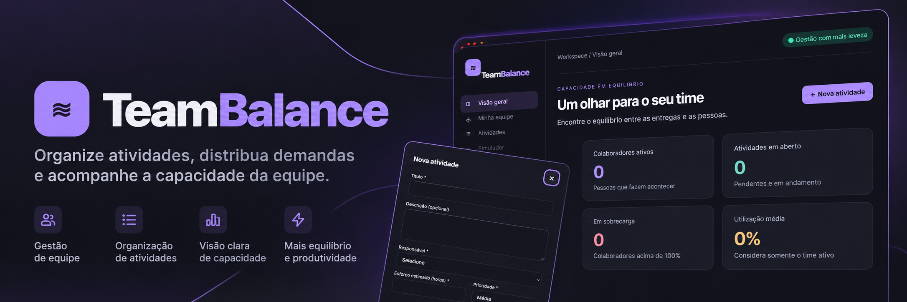

  

    

  **Mais clareza para organizar atividades. Mais equilíbrio para distribuir demandas.**

  [**Acessar aplicação**](https://roxanenayara.github.io/teambalance/)

---

## Sobre o TeamBalance

O **TeamBalance** é uma aplicação web que ajuda a organizar atividades, acompanhar a capacidade de trabalho e distribuir demandas de forma mais consciente.

Em uma interface simples e visual, é possível acompanhar a disponibilidade da equipe, identificar situações de sobrecarga e simular novas atribuições antes de confirmá-las.

A proposta é reunir as informações essenciais para o dia a dia da gestão, sem complicar a rotina.

## Funcionalidades

### Visão geral

- Indicadores de colaboradores ativos, atividades em aberto e pessoas em sobrecarga.
- Percentual médio de utilização da equipe ativa.
- Visualização da carga de trabalho de cada colaborador ativo.
- Resumo de atividades prioritárias.

### Minha equipe

- Cadastro e edição de colaboradores.
- Definição de função e capacidade semanal em horas.
- Ativação e desativação de colaboradores.
- Acompanhamento de horas alocadas, horas disponíveis e percentual de utilização.

### Atividades

- Cadastro, edição e exclusão de atividades.
- Definição de responsável, esforço estimado, prioridade, prazo e status.
- Pesquisa por título e filtros por responsável, prioridade e status.
- Atualização da carga de trabalho conforme as atividades são alteradas.

### Simulador de distribuição

- Simulação do impacto de uma nova atividade na capacidade de um colaborador.
- Comparação entre carga atual e carga projetada.
- Identificação de horas excedentes e situações de sobrecarga.
- Confirmação antes de salvar uma distribuição que ultrapasse a capacidade.

## Como funciona o cálculo de capacidade?

O TeamBalance considera a **capacidade semanal cadastrada** para cada colaborador e soma os esforços estimados das atividades com status **Pendente** ou **Em andamento**.

- **Horas alocadas:** soma das estimativas das atividades abertas.
- **Horas disponíveis:** capacidade semanal − horas alocadas.
- **Utilização:** (horas alocadas ÷ capacidade semanal) × 100.

| Utilização | Classificação |
| --- | --- |
| Abaixo de 70% | Disponibilidade confortável |
| De 70% a 100% | Atenção à capacidade |
| Acima de 100% | Sobrecarga |

> **Nota:** a carga é agregada, sem distribuição automática por dia ou semana. Atividades concluídas e canceladas não entram no cálculo de horas alocadas.

## Regras de Negócio

O TeamBalance possui uma especificação funcional que estabelece as regras de cadastro, gerenciamento de atividades, cálculo de capacidade, distribuição de demandas e persistência dos dados.

As regras estão organizadas por funcionalidades e identificadas individualmente para facilitar sua consulta e manutenção.

[Consultar Regras de Negócio — Versão 1.0](docs/Regras_de_Negocio_v1.0.md)

## Tecnologias utilizadas

- **HTML5** — estrutura da aplicação.
- **CSS3** — estilização, tema escuro e layout responsivo.
- **JavaScript** — interações, validações, cálculos e atualização da interface.
- **localStorage** — persistência dos registros no navegador.
- **GitHub Pages** — publicação da aplicação.

O projeto funciona como uma aplicação de página única (*Single Page Application*), sem necessidade de backend ou login.

## Desenvolvimento com Inteligência Artificial

O TeamBalance foi criado com o apoio de inteligência artificial generativa, a partir de um prompt estruturado que descreveu o objetivo da aplicação, suas funcionalidades, regras de negócio e diretrizes de interface.

A IA foi utilizada para gerar a implementação inicial em HTML, CSS e JavaScript, demonstrando como instruções em linguagem natural podem ser transformadas em uma aplicação web funcional.

O projeto explora o uso da IA como ferramenta de apoio à criação de soluções digitais, mantendo a importância da definição de requisitos, da análise crítica e da validação do comportamento da aplicação.

## Como usar

1. Acesse o [**TeamBalance**](https://roxanenayara.github.io/teambalance/).
2. Em **Minha equipe**, cadastre colaboradores e informe a capacidade semanal de cada um.
3. Em **Atividades**, registre as demandas e seus responsáveis.
4. Consulte a **Visão geral** para acompanhar indicadores e a carga da equipe.
5. Use o **Simulador** para avaliar o impacto de novas atividades antes da distribuição.

Se quiser conhecer as funcionalidades com informações fictícias, utilize a opção **Carregar dados de exemplo**. Essa ação substitui os registros locais existentes após confirmação.

## Armazenamento dos dados

Os registros são armazenados **localmente no navegador**, sem sincronização entre dispositivos ou usuários.

Isso significa que cada navegador mantém seus próprios dados. Limpar os dados do site ou restaurar a aplicação pode remover os registros salvos localmente.

> O TeamBalance não oferece contas de usuário, banco de dados compartilhado ou colaboração em tempo real nesta versão.

## Executar localmente

Para usar sem GitHub Pages, baixe o arquivo `index.html` deste repositório e abra-o em um navegador moderno.

## Acessar o projeto

**Aplicação:** https://roxanenayara.github.io/teambalance/

---

  <strong>TeamBalance</strong> 
  Organize as entregas. Visualize a capacidade. Encontre mais equilíbrio.

